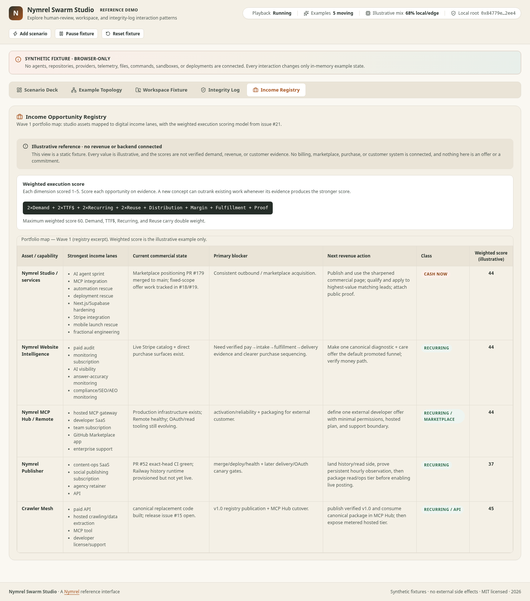
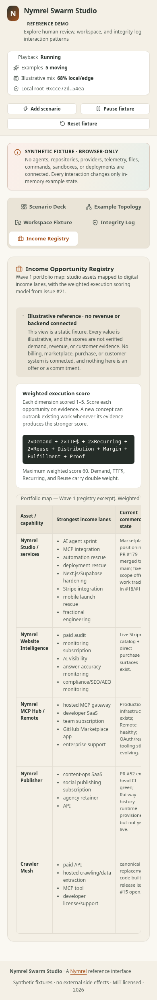

# Income registry contribution verification

Reviewed October 18, 2026 on Linux, Node.js 24.19.0, npm 11.19.1,
Chromium 151.0.7922.173 and axe-core 4.10.3. Application source tested:
`de94687d3b7ac46e509f8211f072683a9a127ada` (tree
`6fa00b3ac16ad123e21076d47b70b19d8fae4329`). This receipt and the screenshots
are documentation added after that verification.

The integration preserves [LORDSINE's contribution in PR #25](https://github.com/nymrel/nymrel-swarm-studio/pull/25)
at `942e20a58a86eaf6617a22c307e77265ded7ad49`, merged onto main
`36c91b30795145a049fc192753b7e07bd8138784`. The maintainer follow-up adds a
caption-named, keyboard-focusable region around the horizontal table. The five
rows and their scores remain illustrative fixtures. This is partial work toward
[issue #21](https://github.com/nymrel/nymrel-swarm-studio/issues/21), not a durable
registry or verified commercial evidence.

## Local validation

```sh
corepack npm@11.19.1 ci --ignore-scripts --no-audit --no-fund
corepack npm@11.19.1 run check
corepack npm@11.19.1 run audit:ci
corepack npm@11.19.1 run preview -- --port 4275
```

The locked install passed with lifecycle scripts disabled. The complete `check`
gate passed lint, TypeScript, 30 tests in four files, 100% coverage of the configured
mock-source scope, static truth checks across 24 product surfaces, production
build and unchanged bundle budgets. Total gzip bytes: 85,077; largest JavaScript
gzip bytes: 79,557. The dependency audit reported zero vulnerabilities.

## Browser review

The production preview at `http://127.0.0.1:4275/` was reviewed at 1440 × 1100 and
390 × 844 viewports, using Playwright Core with installed Chromium and an injected
axe-core audit. These review tools were external to the project; no application
dependency or CI configuration was added. Both screenshots contain only the
existing synthetic fixtures.

- The Income Registry button opens the view with five rows and scores
  44, 44, 44, 37 and 45. The synthetic/static notices remain visible.
- At both widths, Tab from the registry navigation button reaches the named
  table region with a visible focus outline. At phone width, ArrowRight moves
  the table horizontally; the measured scroll moved 40 pixels. The 850-pixel
  table stays inside its 310-pixel scroll area without widening the page.
- Reduced-motion emulation retained the existing reduced-motion rules.
- Request capture recorded no external requests, and no page errors occurred.
- axe reported zero violations at both widths after the fix. Before the fix,
  the phone view reported `scrollable-region-focusable` on the table wrapper.
  Manual palette checks for registry text and badges measured at least 5.7:1
  contrast.

These checks are local evidence, not a completed hosted CI matrix or a full
accessibility certification. axe left manual-review entries for the existing
header's generic labeled element, gradient backgrounds and clipped table text;
the registry palette was checked separately. Safari, Firefox, assistive-technology
announcements and real touch-device behavior were not tested. The phone screenshot
shows the left columns; the remaining columns are reached by horizontal scrolling.

## Screenshots

[Desktop, 1440 × 1100 viewport](evidence/income-registry/desktop-1440.png)



[Phone, 390 × 844 viewport](evidence/income-registry/mobile-390.png)


